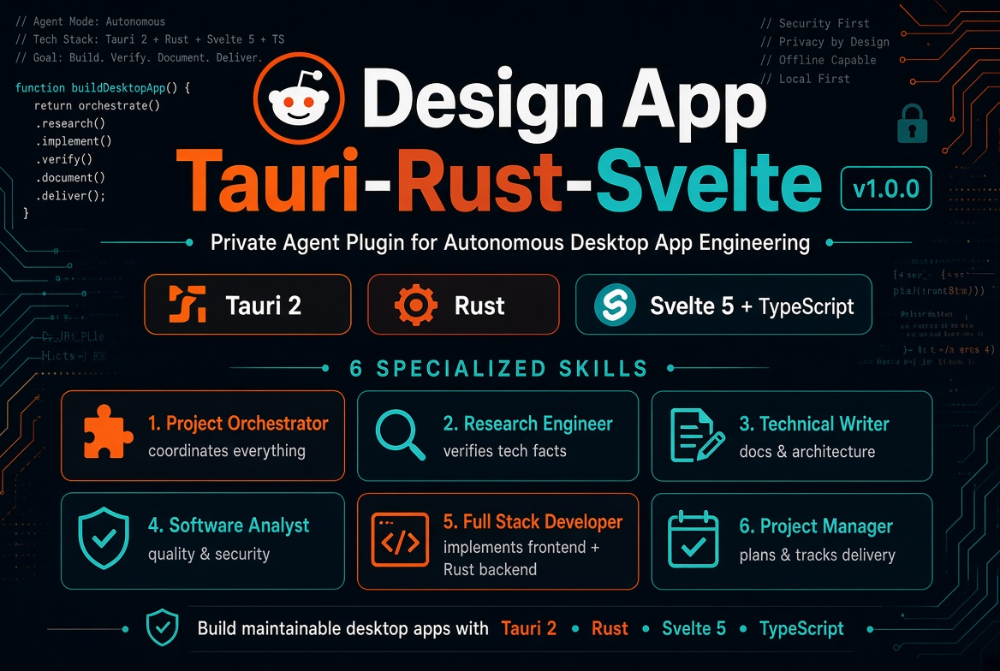

# Design App — Agent Skills para Tauri, Rust, Svelte y TypeScript

<p align="center"></p>

**Seis skills especializados. Un instalador. Un ecosistema amplio de agentes de programación compatibles.**

Design App es un paquete portable basado en Agent Skills para desarrollar aplicaciones de escritorio con Tauri 2, Rust, Svelte 5, TypeScript y Vite. Incluye seis skills y su documentación técnica.

**Web:** https://kathennn.github.io/design-app-tauri-rust-svelte/

**npm:** https://www.npmjs.com/package/design-app-tauri-rust-svelte

**Idiomas:** [English](README.md) · Español
**Publicación:** [Guía para publicar en npm desde Debian](PUBLISHING.md)

## Instalación

Desde el directorio del proyecto:

```bash
npx -y design-app-tauri-rust-svelte
```

Instalación global:

```bash
npx -y design-app-tauri-rust-svelte --global
```

Elegir agentes:

```bash
npx -y design-app-tauri-rust-svelte --agent claude-code,codex,cursor
```

Previsualizar, listar y desinstalar:

```bash
npx -y design-app-tauri-rust-svelte --dry-run
npx -y design-app-tauri-rust-svelte list-agents
npx -y design-app-tauri-rust-svelte uninstall
```

El instalador no sobrescribe skills existentes que no haya creado. La reinstalación actualiza las copias gestionadas por el paquete; la desinstalación elimina únicamente las copias que llevan su marcador.

## Agentes compatibles

El registro sigue convenciones públicas de directorios Agent Skills para Claude Code, Codex, Cursor, Gemini CLI, GitHub Copilot, OpenCode, Cline, Windsurf, Roo Code, OpenClaw, Amp, Goose, Kiro CLI, Qwen Code, Continue y otros.

Agent Skills es un formato compartido; eso no garantiza que todos los productos de IA lo admitan. Cada aplicación debe reconocer la especificación y cargar skills desde su directorio documentado. Algunos agentes propietarios pueden necesitar un adaptador. Consulta la [matriz upstream](https://github.com/vercel-labs/skills/blob/main/docs/agents.md).

## Seis skills

| Skill | Función |
|---|---|
| `project-orchestrator` | Coordina la entrega completa |
| `research-engineer` | Investiga APIs, dependencias y decisiones técnicas |
| `fullstack-developer` | Implementa Svelte, TypeScript, Tauri y Rust |
| `software-analyst` | Revisa arquitectura, seguridad y pruebas |
| `project-manager` | Planifica hitos, riesgos y aceptación |
| `technical-writer` | Redacta documentación y notas de versión |

Cada skill incluye sus propias referencias para poder instalarse de forma independiente.

## Requisitos y desarrollo

- Node.js 18 o superior; sin dependencias de ejecución.
- Instalación local por defecto; `--global` usa directorios del usuario.
- `--agent all` es el valor predeterminado; admite IDs separados por comas.
- Recarga el agente si no detecta los nuevos skills.

```bash
npm test
npm run pack:check
node --check bin/design-app.js
node bin/design-app.js list-agents
```

## Licencia

Design App se distribuye bajo los términos propietarios de [`LICENSE`](LICENSE). Se permite descargar, instalar y utilizar los skills, incluidas las copias técnicas necesarias para instalarlos y ejecutarlos. No se concede permiso para modificarlos ni redistribuirlos. Todos los derechos quedan reservados a su titular. Es un acuerdo propietario específico del proyecto, no una licencia de código abierto aprobada por OSI. Lee el texto completo antes de utilizar el paquete.

## Versión y publicación

Versión **1.1.2**, publicada en npm. La web del proyecto se configura mediante GitHub Pages. Consulta [PUBLISHING.md](PUBLISHING.md) para seguir el proceso desde Debian.

[@kathennn](https://github.com/kathennn)
