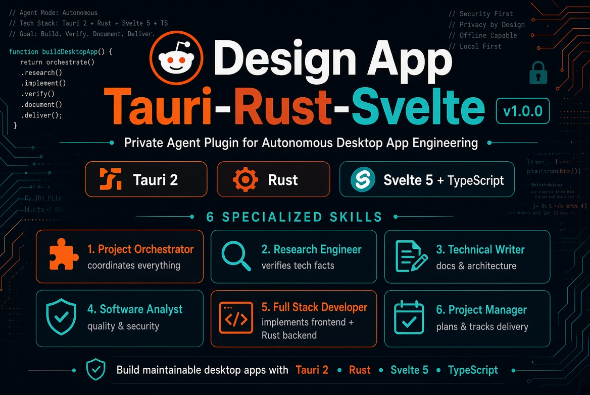

# Design App — Agent Skills for Tauri, Rust, Svelte and TypeScript

<p align="center"></p>
<p align="center"><strong>Six specialist engineering skills. One installer. A broad ecosystem of compatible AI coding agents.</strong></p>

Design App is a portable Agent Skills package for engineering desktop applications with Tauri 2, Rust, Svelte 5, TypeScript and Vite. It includes six focused skills and their technical references.

**Website:** https://kathennn.github.io/design-app-tauri-rust-svelte/

**npm:** https://www.npmjs.com/package/design-app-tauri-rust-svelte

**Publishing guide:** [Publish to npm from Debian](PUBLISHING.md)

## One-command installation

Run in the project directory where you want the skills installed:

```bash
npx -y design-app-tauri-rust-svelte
```

Global installation:

```bash
npx -y design-app-tauri-rust-svelte --global
```

Select agents:

```bash
npx -y design-app-tauri-rust-svelte --agent claude-code,codex,cursor
```

Preview, list agents, and uninstall:

```bash
npx -y design-app-tauri-rust-svelte --dry-run
npx -y design-app-tauri-rust-svelte list-agents
npx -y design-app-tauri-rust-svelte uninstall
```

The installer will not overwrite existing skills it does not manage. Reinstallation updates package-managed copies; uninstall removes only copies carrying its ownership marker.

## Supported agent ecosystem

The compatibility registry follows public Agent Skills directory conventions for Claude Code, Codex, Cursor, Gemini CLI, GitHub Copilot, OpenCode, Cline, Windsurf, Roo Code, OpenClaw, Amp, Goose, Kiro CLI, Qwen Code, Continue and others.

Agent Skills is a shared format, not a guarantee that every AI product supports skills. Each host must recognize the specification and load skills from its documented directory. Proprietary agents may require an adapter. See the [upstream compatibility matrix](https://github.com/vercel-labs/skills/blob/main/docs/agents.md).

## Included skills

| Skill | Purpose |
|---|---|
| `project-orchestrator` | Coordinates end-to-end delivery |
| `research-engineer` | Researches APIs, dependencies and technical choices |
| `fullstack-developer` | Implements Svelte, TypeScript, Tauri and Rust |
| `software-analyst` | Reviews architecture, security and tests |
| `project-manager` | Plans milestones, risks and acceptance criteria |
| `technical-writer` | Creates technical docs and release notes |

Each skill contains its own references so it can be installed independently.

## Requirements and development

- Node.js 18 or newer; no runtime dependencies.
- Project-local installation by default; `--global` uses user-level directories.
- `--agent all` is the default; selected IDs can be comma-separated.
- Reload the target agent if it does not discover new skills immediately.

```bash
npm test
npm run pack:check
node --check bin/design-app.js
node bin/design-app.js list-agents
```

## License and ownership

Design App is distributed under the proprietary terms in [`LICENSE`](LICENSE). They permit downloading, installing, and using the skills, including technical copies required for installation and execution. They do not grant permission to modify or redistribute the Materials. All rights are reserved by the copyright holder. This is a project-specific proprietary agreement, not an OSI-approved open-source license. Read the full terms before use.

## Version and publication

Version **1.1.3**, published on npm. The project website is configured for GitHub Pages. See [PUBLISHING.md](PUBLISHING.md) for the Debian publishing guide.

Maintainer: [@kathennn](https://github.com/kathennn)
